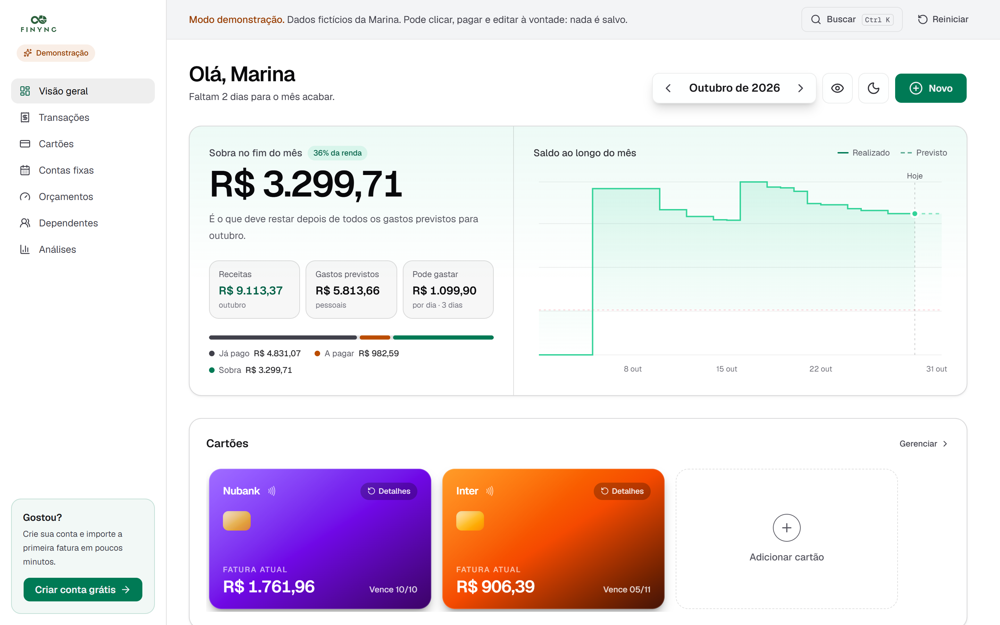
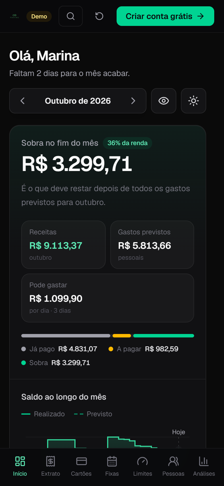

<div align="center">


**Gerenciador financeiro pessoal para quem vive de cartão de crédito, contas fixas e gastos divididos.**

[**finync.com.br**](https://finync.com.br) · [**Ver a demonstração**](https://finync.com.br/demo) (sem cadastro, dados fictícios)


</div>

<picture>
  <source media="(prefers-color-scheme: dark)" srcset=".github/assets/dashboard-dark.png" />
  
</picture>

## O que o Finync faz

O Finync responde a uma pergunta: **quanto vai sobrar no fim do mês?** Para isso ele junta receitas, contas fixas e faturas de cartão na competência certa, e separa o que é seu do que outras pessoas te devem.

- **Cartões e faturas:** cada compra cai na fatura do mês certo conforme o dia de fechamento, com parcelamentos, créditos e pagamento de fatura.
- **Importação de faturas e extratos:** lê PDF (com OCR para arquivos escaneados), CSV e OFX dos principais bancos brasileiros. Antes de salvar, mostra uma revisão editável com categoria sugerida, nome do estabelecimento limpo e aviso de duplicidade.
- **Contas fixas e recorrências:** assinaturas, salários e contas do mês, com status de pago, pendente e vencido.
- **Dependentes:** gastos feitos para outras pessoas ficam separados do seu orçamento, com controle do que já foi acertado.
- **Orçamentos por categoria:** limites mensais com alerta de consumo.
- **Análises:** evolução mensal e distribuição por categoria.
- **Histórico de atividades:** cada alteração fica registrada e pode ser desfeita.
- **Integridade dos dados:** uma verificação encontra registros inconsistentes (parcelas órfãs, categorias inválidas) e oferece correções seguras.
- **Exportação:** relatórios em CSV e backup completo em JSON.
- **Busca global** (`Ctrl K`), tema claro e escuro, layout próprio para celular, recuperação de senha e exclusão real da conta.

<p align="center">
  
</p>

## Decisões técnicas

- **Segurança no banco, não só na tela.** Toda tabela usa Row Level Security do Postgres: o banco só devolve as linhas do usuário autenticado, mesmo que alguém chame a API diretamente. Operações sensíveis, como excluir a conta, rodam em funções do banco.
- **Sessão no servidor.** A autenticação usa `@supabase/ssr` com cookies. O `proxy.ts` do Next renova a sessão e protege as rotas antes de a página renderizar.
- **Regras de negócio puras e testadas.** Fechamento de fatura, competência, parcelas, recorrências, acertos de dependentes e leitura dos arquivos ficam em `lib/` como funções sem efeito colateral, cobertas por testes com o test runner nativo do Node.
- **Importação toda no navegador.** O PDF é lido com `pdfjs-dist` e, quando não tem texto, passa por OCR com `tesseract.js`. O arquivo do banco nunca sai do computador do usuário.
- **Demonstração com as páginas reais.** A rota `/demo` roda os mesmos componentes do app sobre dados em memória, então quem visita testa o produto de verdade sem criar conta e sem tocar no banco.
- **Tipos gerados do banco.** `lib/database.types.ts` é gerado a partir do schema do Supabase, e o `npm run db:types:check` falha se o código e o banco divergirem.
- **Testes de ponta a ponta.** O Playwright cobre rotas públicas, a demonstração, o tema e um fluxo autenticado, em desktop e em celular.

## Tecnologias

| Área | Ferramentas |
|---|---|
| App | Next.js 16 (App Router, React Compiler), React 19, TypeScript |
| Interface | Tailwind CSS 4, Radix UI, Base UI, Framer Motion, Recharts, Lucide, Sonner |
| Estado | Zustand |
| Backend | Supabase (Postgres, Auth, Storage, RLS) |
| Importação | pdfjs-dist, tesseract.js, Papa Parse, leitor de OFX próprio |
| Qualidade | Node test runner, Playwright, ESLint, `tsc --noEmit` |

## Rodando localmente

Pré-requisitos: Node.js 22 ou mais recente e um projeto no [Supabase](https://supabase.com).

```bash
git clone https://github.com/joaoshimoda/finync-app.git
cd finync-app
npm install
```

Crie um arquivo `.env.local` na raiz:

```bash
NEXT_PUBLIC_SUPABASE_URL=https://<seu-projeto>.supabase.co
NEXT_PUBLIC_SUPABASE_ANON_KEY=<sua-anon-key>
```

```bash
npm run dev        # http://localhost:3000
```

As migrations do banco não fazem parte da versão pública deste repositório. Para conhecer o app sem configurar nada, use a [demonstração online](https://finync.com.br/demo).

### Scripts

| Comando | O que faz |
|---|---|
| `npm run dev` | Servidor de desenvolvimento |
| `npm run build` | Build de produção |
| `npm test` | Testes unitários das regras de negócio |
| `npm run test:e2e` | Testes de ponta a ponta com Playwright |
| `npm run typecheck` | Checagem de tipos |
| `npm run lint` | ESLint |

## Estrutura

```
app/          rotas (App Router): landing, autenticação, dashboard, demo, páginas legais
components/   componentes por área (cards, import, dependents, budgets, ui...)
lib/          regras de negócio puras, leitores de PDF/CSV/OFX, tipos do banco
store/        estado global (Zustand)
tests/        testes unitários
e2e/          testes Playwright
proxy.ts      sessão e proteção de rotas
```

## Licença

[MIT](LICENSE) © João Shimoda
